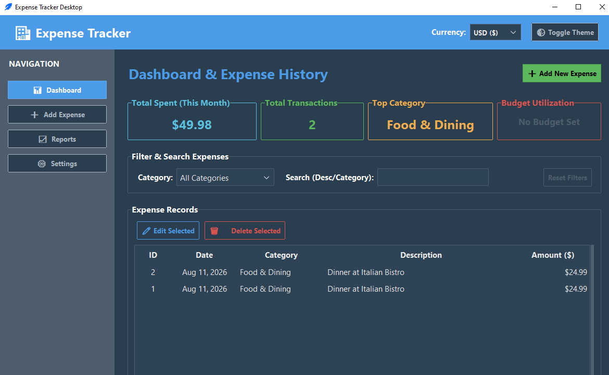
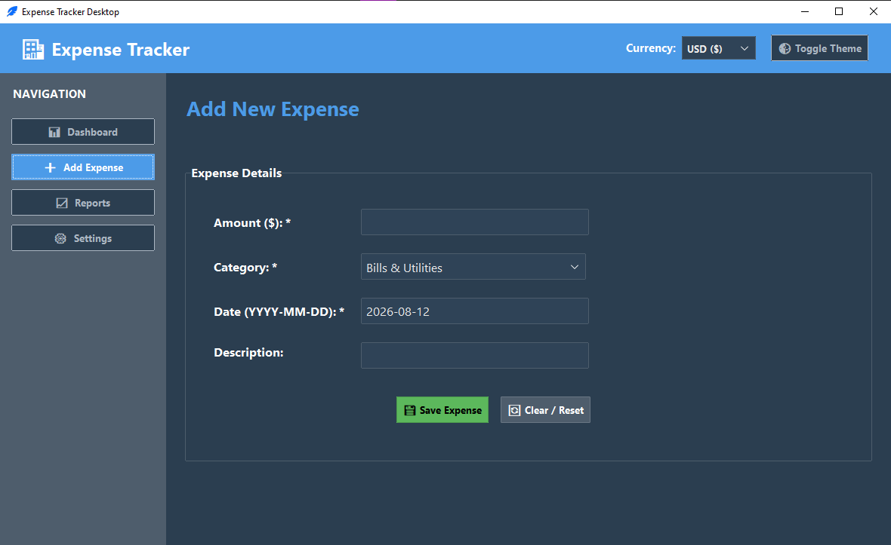
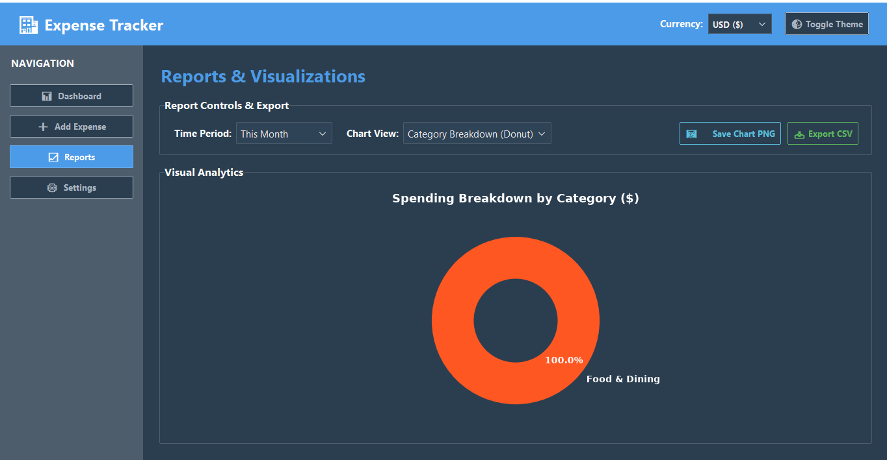
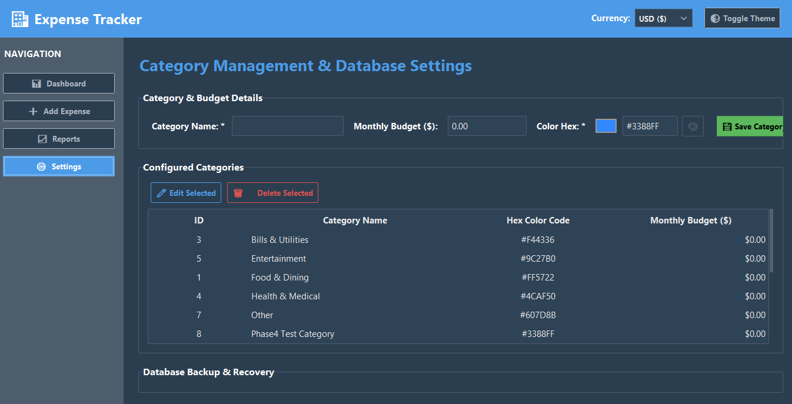

# 🏦 Expense Tracker — Desktop Application

A modern, feature-rich desktop financial management application built in Python. **Expense Tracker** empowers users to log daily expenses, organize spending into customizable categories, set monthly budget caps, visualize spending habits with interactive charts, and export financial data.

---

## 🌟 Key Features

### 📊 1. Interactive Dashboard
- **Summary Cards**: Real-time metrics for Total Monthly Spend, Total Transactions, Top Spending Category, and overall Budget Utilization %.
- **Expense Records Table**: Scrollable history list showing date, category, description, and currency-formatted amount.
- **Real-Time Filtering & Search**: Instant description and category full-text search bar.
- **Row Actions**: One-click **Edit Selected** expense and **Delete Selected** expense with confirmation dialogs.

### ➕ 2. Expense Logging & Management
- **Add & Edit Form**: Intuitive form with input validation for amounts, dates (`YYYY-MM-DD`), and descriptions.
- **Category Assignment**: Assign expenses to custom categories with dynamic dropdown selection.

### 📈 3. Visual Analytics & Reports
- **Category Breakdown (Donut Chart)**: Interactive Matplotlib pie/donut visualization displaying category spending distribution.
- **Monthly Spending Trend (Bar Chart)**: Historical trend bar chart over selectable time frames (This Month, Last 3 Months, Last 6 Months, This Year, All Time).
- **Export Options**: 
  - 📥 **Export to CSV**: Export filtered or full expense history to a `.csv` file.
  - 🖼️ **Save Chart PNG**: Save active chart visualizations as high-resolution `.png` images.

### ⚙️ 4. Category & Budget Management
- **Custom Categories**: Create, edit, and delete categories with a custom **Color Picker (`🎨`)**.
- **Monthly Budget Caps**: Set monthly budget limits per category and monitor real-time spending progress bars.

### 💾 5. Data Backup & Recovery
- **Database Backup (`📦`)**: Export complete SQLite database snapshots (`.db`) to any folder.
- **Database Restore (`📥`)**: Restore previous database backups seamlessly.

### 💱 6. Multi-Currency & Customizable Themes
- **Global Currency Switcher**: Switch between **USD ($)**, **EUR (€)**, **GBP (£)**, **INR (₹)**, **JPY (¥)**, **CAD (CA$)**, **AUD (A$)**, and **BRL (R$)** in real-time.
- **Theme Toggle (`🌓`)**: Toggle between Light Mode and Dark Mode with automated high-contrast typography styling.

---

## 📸 Application Screenshots

> *Paste your application screenshots inside the `assets/` folder using the suggested filenames below:*

### Dashboard View


### Add / Edit Expense Form


### Reports & Visual Analytics


### Category Management & Settings


---

## 🛠️ Technology Stack

- **GUI Framework**: Python `tkinter` + `ttkbootstrap`
- **Database**: SQLite3 (Embedded local relational storage)
- **Data Visualization**: Matplotlib (`TkAgg` backend) & Seaborn
- **Architecture**: Modular MVC-inspired architecture (Data Models, SQLite Access Layer, Tkinter View Frames)
- **Testing**: Standard Python `unittest` suite (14 test cases passing)

---

## 🚀 Steps to Run the Application

### 1. Prerequisites
Ensure you have **Python 3.9+** installed on your system.

### 2. Navigate to Project Directory
Open your terminal / PowerShell and navigate to the project directory:

```powershell
cd "EXPENSE TRACKER"
```

### 3. Create & Activate Virtual Environment

```powershell
# Create virtual environment (if not already created)
python -m venv .venv

# Activate virtual environment on Windows PowerShell
.\.venv\Scripts\Activate.ps1
```

*(On macOS/Linux, activate using `source .venv/bin/activate`)*

### 4. Install Dependencies

```powershell
pip install -r requirements.txt
```

### 5. Launch the Application

Run the main application script:

```powershell
python main.py
```

---

## 🧪 Running Automated Unit Tests

To run the full automated unit test suite covering database queries, input validators, GUI shell routing, form submissions, and database backup logic:

```powershell
python -m unittest discover -s tests
```

---

## 📂 Directory Structure Overview

```
EXPENSE TRACKER/
├── main.py                  # Main application launcher
├── requirements.txt         # Package dependencies
├── user_settings.json       # Persisted user preferences (Currency & Theme)
├── expense_tracker.db       # Local SQLite database file
├── assets/                  # Application screenshot images
│   ├── dashboard.png
│   ├── add_expense.png
│   ├── reports.png
│   └── settings.png
├── db/
│   ├── database.py          # SQLite connection & table schema initializer
│   └── queries.py           # CRUD query engine & aggregate report queries
├── models/
│   └── expense.py           # Category & Expense dataclass models
├── ui/
│   ├── app.py               # Main window shell & view router
│   ├── dashboard.py         # Dashboard view & interactive Treeview table
│   ├── add_expense.py       # Add & Edit expense form view
│   ├── reports.py           # Matplotlib reports view & exporter UI
│   └── settings.py          # Category manager & DB backup/restore view
├── utils/
│   ├── backup.py            # SQLite database backup & restore helper
│   ├── config.py            # User settings manager
│   ├── exporters.py         # CSV export utility
│   ├── formatters.py        # Currency & Date string formatters
│   └── validators.py        # Input validation helpers
└── tests/                   # Automated unit test suite
    ├── test_crud.py
    ├── test_gui_shell.py
    ├── test_phase4_forms.py
    ├── test_phase5_reports.py
    └── test_phase6_advanced.py
```
